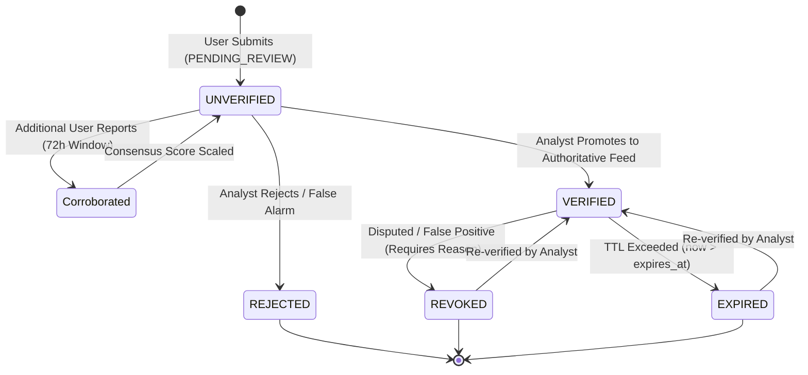

# Threat Indicator Schema & Lifecycle Specification

## 1. Specification Overview

This document specifies the normalized, versioned threat indicator schema and lifecycle state machine for the **Squish Quishing and Smishing Detection System** (Schema Version `v1.0`).

All indicator models conform to strict data-minimization rules, eliminating raw message bodies, personal identifying information, and unverified attribution claims.

---

## 2. Threat Indicator Data Model (`threat_intel`)

The authoritative repository of verified indicators utilized for fast lookups, edge caching, and incident investigation.

### Field Definitions

| Field Name | Type | Constraints | Description |
| :--- | :--- | :--- | :--- |
| `id` | UUID (String 36) | Primary Key | Unique indicator identifier. |
| `indicator_type` | String(32) | Indexed, Not Null | Indicator format: `URL`, `DOMAIN`, `IP`, `CAMPAIGN`. |
| `indicator_value` | String(512) | Unique, Indexed, Not Null | Canonicalized indicator value (normalized URL or lowercase hostname). |
| `threat_type` | String(32) | Indexed, Not Null | Threat category: `QUISHING`, `SMISHING`, `PHISHING`, `MALWARE`. |
| `confidence` | Float | `0.0 <= c <= 1.0` | Confidence rating (1.0 = confirmed by analyst or authoritative feed). |
| `source` | String(64) | Not Null | Provenance source: `INTERNAL`, `URLHAUS`, `PHISHTANK`, `GSB`, `COMMUNITY`. |
| `first_seen` | Timestamp with TZ | Not Null | UTC timestamp when indicator was first recorded. |
| `last_seen` | Timestamp with TZ | Not Null | UTC timestamp when indicator was most recently observed or corroborated. |
| `status` | String(32) | Indexed, Not Null | Operational status: `ACTIVE`, `VERIFIED`, `EXPIRED`, `REVOKED`. |
| `verification_status` | String(32) | Indexed, Not Null | Authoritative lifecycle status: `UNVERIFIED`, `VERIFIED`, `EXPIRED`, `REVOKED`. |
| `expires_at` | Timestamp with TZ | Nullable, Indexed | TTL expiration timestamp. Active lookups filter out indicators where `now > expires_at`. |
| `revocation_reason` | String(512) | Nullable | Mandatory analyst rationale when status is transitioned to `REVOKED`. |
| `promoted_from_report_id` | UUID (String 36) | Nullable, FK | Foreign key to source `community_threat_reports.id` if promoted from a user report. |
| `metadata_json` | JSONB / Dict | Nullable | Contextual tags, promotion provenance, feed sync telemetry, or campaign markers. |

---

## 3. Community Threat Report Model (`community_threat_reports`)

Captures voluntary, privacy-scrubbed submissions from mobile edge devices.

### Field Definitions

| Field Name | Type | Constraints | Description |
| :--- | :--- | :--- | :--- |
| `id` | UUID (String 36) | Primary Key | Unique community report identifier. |
| `reporter_user_id` | UUID (String 36) | Foreign Key, Nullable | Reporter user ID (protected by server-side query filters; never exposed in public views). |
| `anonymous_submission_id` | UUID (String 36) | Unique, Indexed, Not Null | Pseudonymous public tracking ID for dashboards and audit trails. |
| `indicator_type` | String(32) | Indexed, Not Null | Indicator format: `URL`, `DOMAIN`, `CAMPAIGN`. |
| `indicator_value` | String(512) | Indexed, Not Null | Sanitized, token-redacted target destination. |
| `indicator_hash` | String(64) | Indexed, Not Null | SHA-256 hexadecimal hash of canonical indicator for deduplication. |
| `threat_category` | String(32) | Indexed, Not Null | Local threat verdict: `QUISHING`, `SMISHING`, `PHISHING`, `MALICIOUS_CAMPAIGN`. |
| `user_risk_score` | Integer | `0 <= score <= 100` | Risk score generated by client TinyBERT/XGBoost engine. |
| `model_verdicts` | JSONB / Dict | Nullable | Local inference probabilities: `{"tinybert": 0.85, "xgboost": 0.78}`. |
| `context_metadata` | JSONB / Dict | Nullable | Structural non-PII attributes: `{"protocol": "https", "qr_scanned": true}`. |
| `status` | String(32) | Indexed, Not Null | Triage state: `PENDING_REVIEW`, `PROMOTED`, `REJECTED`. |
| `consensus_score` | Float | `0.0 <= score <= 1.0` | Multi-user weighted consensus score. |
| `corroboration_count` | Integer | Default 1, Not Null | Number of independent user reports corroborating this indicator hash. |
| `admin_notes` | Text | Nullable | Analyst triage rationale or investigation notes. |
| `reviewed_by_admin_id` | UUID (String 36) | Foreign Key, Nullable | Admin user ID who performed triage. |
| `reviewed_at` | Timestamp with TZ | Nullable | Timestamp of triage decision. |
| `promoted_indicator_id` | UUID (String 36) | Foreign Key, Nullable | ID of resulting `threat_intel` indicator upon promotion. |
| `submitted_at` | Timestamp with TZ | Not Null | Timestamp of initial submission. |
| `updated_at` | Timestamp with TZ | Not Null | Timestamp of most recent corroboration or status update. |
| `ip_origin_masked` | String(64) | Nullable | Anonymized or /16 masked subnet origin (e.g., `192.168.0.0/16`). |

---

## 4. User Sharing Preferences Model (`user_sharing_preferences`)

Enforces opt-in consent and privacy preferences per user.

| Field Name | Type | Constraints | Description |
| :--- | :--- | :--- | :--- |
| `id` | UUID (String 36) | Primary Key | Preference identifier. |
| `user_id` | UUID (String 36) | Unique, FK, Not Null | Associated user account. |
| `is_sharing_enabled` | Boolean | Default `False`, Not Null | Explicit opt-in sharing toggle. |
| `consent_version` | String(16) | Default `"v1.0"`, Not Null | Acknowledged privacy policy version. |
| `consent_timestamp` | Timestamp with TZ | Nullable | Timestamp when opt-in was enabled. |
| `allow_campaign_correlation` | Boolean | Default `True`, Not Null | User permission to correlate indicator across campaigns. |
| `withdrawn_at` | Timestamp with TZ | Nullable | Timestamp when sharing was disabled/revoked. |
| `updated_at` | Timestamp with TZ | Not Null | Timestamp of last preference modification. |

---

## 5. Lifecycle State Machine



### State Definitions & Rules
1. **`UNVERIFIED` / `PENDING_REVIEW`**:
   - Indicator is under observation.
   - Lookup reputation returns `SUSPICIOUS` with `is_malicious = False`.
   - Cannot be used to automatically block user communication.
2. **`VERIFIED`**:
   - Indicator confirmed malicious by external feed or SOC analyst promotion.
   - Lookup reputation returns `KNOWN_MALICIOUS` with `is_malicious = True`.
   - Used for immediate blocking and client warning advisories.
3. **`EXPIRED`**:
   - Indicator TTL elapsed without recent observations.
   - Automatically excluded from active blocklists to prevent stale blocking of recycled domains.
4. **`REVOKED`**:
   - Withdrawn manually by an administrator due to dispute or false positive.
   - Mandatory `revocation_reason` must be provided and logged to `audit_logs`.
   - Immediate in-memory cache eviction across all application nodes.

---

## 6. Normalization & Fingerprint Calculation

To calculate the deterministic canonical hash for any URL indicator:

```python
import hashlib
from app.services.url_normalizer import SafeUrlNormalizer

# 1. Normalize URL safely (strips tokens, Punycode decodes, validates SSRF)
norm_result = SafeUrlNormalizer.normalize_url("https://Pay-Pal.com/login?token=xyz123&dest=home")

# 2. Extract canonical URL
canonical_url = norm_result.normalized_url 
# Result: 'https://pay-pal.com/login?dest=home&token=%5BREDACTED%5D'

# 3. Compute SHA-256 fingerprint
indicator_hash = hashlib.sha256(canonical_url.encode("utf-8")).hexdigest()
```
