# Squish Mobile Application — Complete Navigation Map

This document specifies the exact routes, tabs, actions, and filter delegations across the Squish Android mobile application and Web Dashboard.

---

## 1. Top-Level Bottom Navigation Tabs

The main `DashboardScreen` provides 5 primary bottom navigation tabs:

| Tab Index | Tab Name | Primary Purpose | Key Destination Composable |
| :--- | :--- | :--- | :--- |
| **0** | **Home** | Real-time safety overview, live activity counters, quick actions, daily tip, and recent activity. | `HomeTab` |
| **1** | **History** | Searchable, filtered list of all past SMS and QR scan evaluations. Supports filter deep-linking. | `HistoryTab` |
| **2** | **Scanner** | On-device text and message inspection, URL safety analysis, rule explanations, and AI query tool. | `ScannerTab` |
| **3** | **Alerts** | High-priority security triage for dangerous or suspicious threats requiring user review. | `AlertsTab` |
| **4** | **Settings** | Real-time protection toggles, notification thresholds, cloud sync telemetry, and AI opt-ins. | `SettingsTab` |

---

## 2. Dashboard Home Tab Navigation & Quick Actions

```mermaid
flowchart TD
    Home["Home Dashboard (Tab 0)"]
    
    %% Section 1: SMS Activity Cards
    Home -->|"Click SMS Total"| HistSMSAll["HistoryTab (Type: Messages, Sev: All)"]
    Home -->|"Click SMS Safe"| HistSMSSafe["HistoryTab (Type: Messages, Sev: Looks Safe)"]
    Home -->|"Click SMS Attention"| HistSMSAttn["HistoryTab (Type: Messages, Sev: Needs Attention)"]
    Home -->|"Click SMS Dangerous"| HistSMSDang["HistoryTab (Type: Messages, Sev: Dangerous)"]

    %% Section 2: QR Activity Cards
    Home -->|"Click QR Total"| HistQRAll["HistoryTab (Type: QR Codes, Sev: All)"]
    Home -->|"Click QR Safe"| HistQRSafe["HistoryTab (Type: QR Codes, Sev: Looks Safe)"]
    Home -->|"Click QR Attention"| HistQRAttn["HistoryTab (Type: QR Codes, Sev: Needs Attention)"]
    Home -->|"Click QR Dangerous"| HistQRDang["HistoryTab (Type: QR Codes, Sev: Dangerous)"]

    %% Section 3: Alerts Card
    Home -->|"Click Alerts 'View All'"| AlertsTab["AlertsTab (Tab 3)"]
    Home -->|"Click Alert Item"| ScanDetails["ScanDetailsDialog (Full Triage)"]

    %% Section 4: Quick Actions
    Home -->|"Action: Check SMS"| ScannerTab["ScannerTab (Tab 2)"]
    Home -->|"Action: Scan QR"| CameraScanner["Live Camera QR Scanner (Screen.QrScanner)"]
    Home -->|"Action: Alerts"| AlertsTab
    Home -->|"Action: Academy"| SquishAcademy["Squish Academy (Screen.Education)"]

    %% Section 5: Daily Security Tip
    Home -->|"Click Tip Card"| TipDialog["Expanded Daily Tip Dialog"]
    Home -->|"Tip Action: Academy"| SquishAcademy

    %% Section 6 & 7: Recent Activity
    Home -->|"SMS 'View All'"| HistSMSAll
    Home -->|"QR 'View All'"| HistQRAll
    Home -->|"Click Any Recent Record"| ScanDetails
```

---

## 3. Filter Matrix Delegations in `HistoryTab`

When navigating into `HistoryTab` from any dashboard card, the following filters are automatically selected and applied:

| Source Action | Target Type Filter | Target Severity Filter | Description |
| :--- | :--- | :--- | :--- |
| **Total Scanned (SMS)** | `Messages` | `All` | Displays all SMS scans performed by the device |
| **Looks Safe (SMS)** | `Messages` | `Looks Safe` | Filters only benign/safe incoming & scanned SMS |
| **Needs Attention (SMS)** | `Messages` | `Needs Attention` | Filters SMS with risk score 40–69 or suspicious elements |
| **Dangerous (SMS)** | `Messages` | `Dangerous` | Filters high-risk smishing, credential theft, or scam ultimatums |
| **Total Scanned (QR)** | `QR Codes` | `All` | Displays all camera & image QR code scans |
| **Looks Safe (QR)** | `QR Codes` | `Looks Safe` | Filters legitimate, benign QR destinations |
| **Needs Attention (QR)** | `QR Codes` | `Needs Attention` | Filters unfamiliar domains or non-standard protocols |
| **Dangerous (QR)** | `QR Codes` | `Dangerous` | Filters quishing, phishing landing pages, and malicious downloads |
| **Recent SMS "View All"** | `Messages` | `All` | Complete SMS chronological history |
| **Recent QR "View All"** | `QR Codes` | `All` | Complete QR chronological history |

---

## 4. Full-Screen Dialogue Flow (`ScanDetailsDialog`)

Whenever an event is clicked, `ScanDetailsDialog` launches with:
- **Responsive Geometry:** Takes 95% screen width and 92% screen height with `imePadding` and full vertical scroll.
- **Section A:** Message Information, sender metadata, verified brand badges, and raw text.
- **Section B:** Clear consumer verdict banner (`LOOKS SAFE`, `NEEDS ATTENTION`, or `DANGEROUS`).
- **Section C:** Plain-English explanation of why this verdict was issued.
- **Section D:** Evaluation Matrix detailing TinyBERT NLP score, XGBoost lexical score, heuristics, and financial safety rules.
- **Section E:** Context-aware safety recommendations (Banking, Package Delivery, Utility Bills, Job Offers).
- **Section F:** User actions:
  - **Mark Safe / False Positive:** Prompts feedback reason, updates local Room status, adjusts sender trust, and syncs to Firestore.
  - **Report Scam:** Confirms threat, reinforces shield learning.
  - **Quarantine / Restore:** Isolates dangerous payloads safely.
  - **Delete Record:** Completely purges entry from Room database.

---

## 5. Standalone Screens and Nested Flows

| Screen Route | Composable | Trigger Source |
| :--- | :--- | :--- |
| `Screen.Splash` | `SplashScreen` | App launch / Cold boot |
| `Screen.Login` | `LoginScreen` | Auth guard if unauthenticated |
| `Screen.Register` | `RegisterScreen` | "Create Account" from Login |
| `Screen.Dashboard` | `DashboardScreen` | Main application shell |
| `Screen.QrScanner` | `QrScannerScreen` | "Scan QR" button on Quick Actions or ScannerTab |
| `Screen.SmsMonitoring` | `SmsMonitoringScreen` | Settings -> SMS Management |
| `Screen.Education` | `EducationScreen` | "Squish Academy" Quick Action or Daily Tip |
| `Screen.SecurityCheck` | `SecurityCheckScreen` | URL check from ScannerTab or ScanDetailsDialog |
| `Screen.PermissionSetup` | `PermissionScreen` | Onboarding or Missing Permissions Banner |

