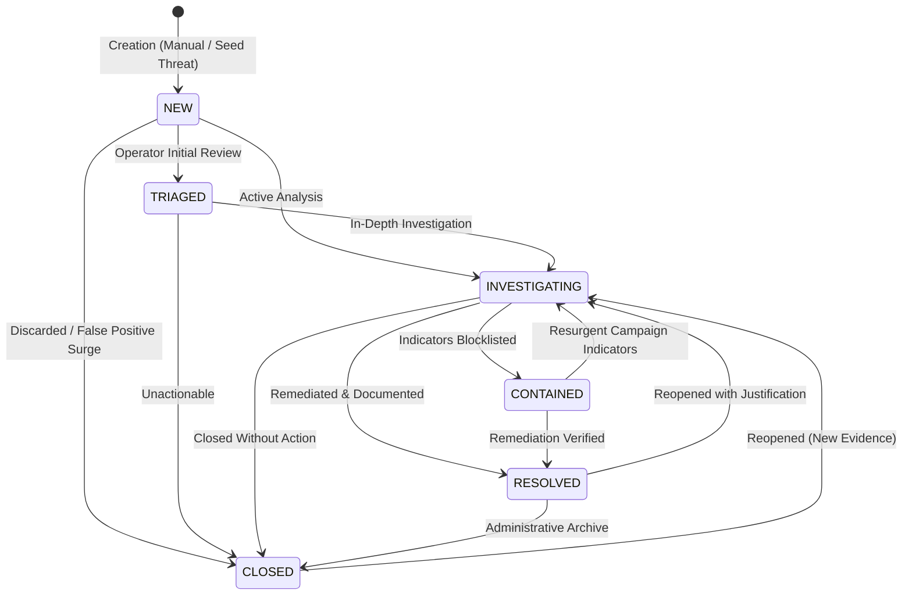

# Incident Management Architecture & Lifecycle Guide

## 1. Overview & Separation of Concerns

In the **Real-Time AI/ML-Based Quishing and Smishing Detection and Prevention System**, an individual smishing or quishing detection on an Android mobile device is **evidence**, not a confirmed security incident.

- **Threat Event (Detection):** An immutable on-device inference record (e.g., TinyBERT SMS classification or XGBoost QR URL prediction) or an authenticated backend telemetry sync. Represents a single observed event with local risk score, confidence, and detection explanations.
- **Security Incident:** An authorized administrative investigation record created by a Security Operations Center (SOC) operator. An incident may group one or more related threat events, provide operational context, record investigation findings, track ownership, and enforce containment actions.

```text
Android Edge Detection
       ↓
Local Threat Event Persistence (Room DB)
       ↓
Authenticated Telemetry Sync
       ↓
FastAPI Ingestion & Threat Intel Enrichment
       ↓
Heuristic Threat Correlation
       ↓
Security Incident Management (SOC Console)
       ↓
Investigation Dossier & Containment Actions
       ↓
Tamper-Evident Incident Audit Trail
```

---

## 2. Incident Schema & Entity Relationship

The incident subsystem is modeled in PostgreSQL (with SQLite WAL dev fallback) and managed via Alembic migration `005_add_incident_management`:

### 2.1 Entities

1. **`Incident` (`incidents` table)**
   - `id`: UUID (String 36, Primary Key)
   - `title`: Short descriptive title (String 255)
   - `description`: Detailed hypothesis, threat indicators, or campaign background (Text)
   - `severity`: Operational impact rating (`LOW`, `MEDIUM`, `HIGH`, `CRITICAL`)
   - `status`: State machine status (`NEW`, `TRIAGED`, `INVESTIGATING`, `CONTAINED`, `RESOLVED`, `CLOSED`)
   - `category`: Incident categorization (`QUISHING_CAMPAIGN`, `SMISHING_SURGE`, `BRAND_IMPERSONATION`, `MALICIOUS_INFRASTRUCTURE`, `ACCOUNT_TAKEOVER_ATTEMPT`, `UNKNOWN`)
   - `assigned_admin_id`: Foreign key to `users.id` (Restricted to `Role.ADMIN`)
   - `created_by_admin_id`: Foreign key to `users.id` of creator
   - `created_at`, `updated_at`: UTC timestamps
   - `triaged_at`, `contained_at`, `resolved_at`, `closed_at`: Lifecycle milestone timestamps
   - `resolution_summary`: Mandatory post-containment description required upon resolution
   - `metadata_json`: Arbitrary tags, OSINT notes, and campaign indicators (JSONB)

2. **`IncidentThreatLink` (`incident_threat_links` table)**
   - Decoupled association between an `Incident` and a `ThreatEvent`.
   - `relationship_type`: Evidence confidence (`CONFIRMED`, `LIKELY`, `UNVERIFIED`).
   - `correlation_signal`: Signal mechanism (`MATCHING_URL`, `MATCHING_DOMAIN`, `MATCHING_CAMPAIGN`, `MANUAL_CORRELATION`, `SAME_SENDER`).
   - `linked_at`: Timestamp of linkage.
   - `linked_by_admin_id`: User ID of operator who correlated the threat.
   - Enforces unique constraint `(incident_id, threat_event_id)` preventing duplicate linkages.

3. **`IncidentNote` (`incident_notes` table)**
   - Append-only investigation findings and analytical observations.
   - `note_type`: `OBSERVATION`, `ANALYSIS`, `REMEDIATION`, `EVIDENCE_NOTE`.
   - `content`: Markdown text.
   - Preserves historical analytical record even when subsequent findings adjust incident severity.

4. **`IncidentEvent` (`incident_events` table)**
   - Append-only audit record of every state transition, assignment change, severity alteration, and threat correlation event.
   - `event_type`: `INCIDENT_CREATED`, `STATUS_CHANGE`, `SEVERITY_CHANGE`, `ASSIGNMENT_CHANGE`, `THREAT_LINKED`, `THREAT_UNLINKED`, `NOTE_ADDED`, `REOPENED`.
   - `previous_state`, `new_state`, `summary`, `details_json`, `timestamp`.

---

## 3. Incident Lifecycle & Legal State Transitions

To prevent operators from bypassing necessary investigation phases, transitions follow a strict directed acyclic graph with explicit reopening rules:



### 3.1 Transition Rules Table

| Current Status | Allowed Next Statuses | Constraints & Prerequisites |
| :--- | :--- | :--- |
| `NEW` | `TRIAGED`, `INVESTIGATING`, `CLOSED` | Default status on creation. Sets `triaged_at` when moving to `TRIAGED`. |
| `TRIAGED` | `INVESTIGATING`, `CLOSED` | Indicates initial review complete. |
| `INVESTIGATING` | `CONTAINED`, `RESOLVED`, `CLOSED` | Active investigation. Moving to `RESOLVED` requires non-empty `resolution_summary`. |
| `CONTAINED` | `RESOLVED`, `INVESTIGATING` | Indicators blocked or mitigations deployed. Moving to `RESOLVED` requires `resolution_summary`. |
| `RESOLVED` | `CLOSED`, `INVESTIGATING` | Incident resolved. Can only be reopened back to `INVESTIGATING` with a documented `reason`. |
| `CLOSED` | `INVESTIGATING` | Closed incident. Can be reopened to `INVESTIGATING` with documented `reason`. |

---

## 4. Incident Severity Classification

Incident severity is evaluated separately from individual model anomaly/risk scores:

- **`LOW`:** Single unconfirmed detection, minor URL heuristic anomaly, or low-probability smishing text with no confirmed malicious payload or recipient interaction.
- **`MEDIUM`:** Verified smishing or quishing detection using known deceptive templates, brand imitation, or single-user exposure with blocked access.
- **`HIGH`:** Confirmed credential phishing attack, multiple detections matching verified malicious domains from threat intelligence (URLhaus/PhishTank), or brand impersonation targeting banking/finance.
- **`CRITICAL`:** Coordinated campaign actively targeting multiple enterprise users, zero-day quishing campaign, or confirmed account compromise attempts.

---

## 5. Security & Privacy Guarantees

1. **Server-Side RBAC Enforcement:** All incident management endpoints require an authoritative `Role.ADMIN` token claim. Ordinary mobile users receive HTTP 403 Forbidden.
2. **Zero Raw SMS Ingestion:** Neither threat telemetry nor incident records ingest raw SMS message text. Only feature tokens, model scores, domain names, and canonical URLs are persisted.
3. **Sensitive URL Scrubbing:** All query parameters containing credentials, session tokens, or passwords are automatically sanitized to `[REDACTED]` prior to incident linkage.
